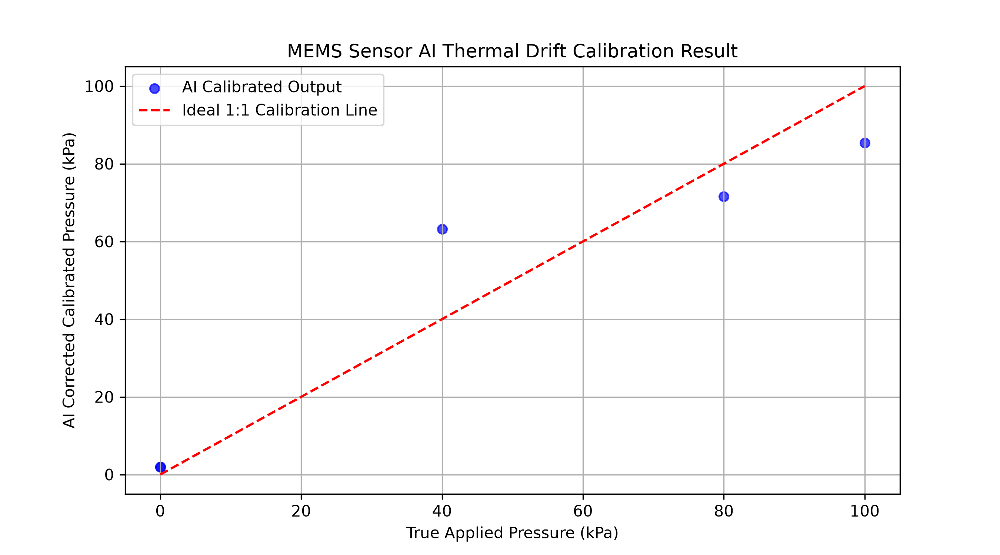

\# MEMS Piezoresistive Pressure Sensor Simulation

# Phase 1: Mechanical Simulation

\- \*\*Diaphragm Dimensions:\*\* 1000 µm × 1000 µm × 20 µm

\- \*\*Substrate Thickness:\*\* 400 µm

\- \*\*Boundary Conditions:\*\* Fixed substrate base, pressure load on diaphragm

\- \*\*Status:\*\* Validated structural mechanics and displacement response.

# Phase 2: Electromechanical \& Piezoresistive Simulation

\### Key Performance Metrics

| Parameter | Symbol | Value | Unit |

| :--- | :--- | :--- | :--- |

| Baseline Resistance | $R\_0$ | 0.25066 | $\\Omega$ |++

| Full-Scale Resistance (100 kPa) | $R\_{\\text{max}}$ | 0.25083 | $\\Omega$ |

| Absolute Resistance Change | $\\Delta R$ | 0.00017 | $\\Omega$ |

| Fractional Resistance Change | $\\Delta R / R\_0$ | 0.0678 | % |

| Sensor Sensitivity | $S$ | $6.78 \\times 10^{-6}$ | $\\text{kPa}^{-1}$ |

\### Simulation Setup

\- \*\*Material:\*\* Single-crystal p-Silicon ($n\_d = 1 \\times 10^{16}\\ \\text{cm}^{-3}$)

\- \*\*Boundary Conditions:\*\* Terminal ($1\\text{ V}$), Ground ($0\\text{ V}$)

\- \*\*Parametric Sweep:\*\* $0$ to $100\\text{ kPa}$ (step: $20\\text{ kPa}$)

\- \*\*Response:\*\* Highly linear electromechanical output

---

# Phase 3: Wheatstone Bridge Integration & Voltage Sensitivity Analysis

## Overview
Integration of a full Wheatstone bridge circuit with the MEMS piezoresistive pressure sensor using COMSOL Multiphysics v6.1 (`Electrical Circuit` interface).

## Simulation Parameters & Results
- **Excitation Voltage ($V_{in}$):** 5.0 V
- **Pressure Range ($P_{app}$):** 0 to 100 kPa
- **Baseline Resistance ($R_0$):** 0.25066 Ω
- **Piezoresistive Sensitivity ($S$):** $6.78 \times 10^{-6}\text{ kPa}^{-1}$
- **Max Differential Output ($V_{out,max}$):** 3.39 mV
- **Total Bridge Sensitivity ($S_{bridge}$):** $0.00678\text{ mV/V/kPa}$ ($6.78\ \mu\text{V/V/kPa}$)

## Bridge Topology & Circuit Configuration
- **Full Wheatstone Bridge** connected via Nodes 0, 1, 2, 3
- **Tension Arms ($R_1, R_4$):** $R_0 (1 + S \cdot P_{app})$
- **Compression Arms ($R_2, R_3$):** $R_0 (1 - S \cdot P_{app})$
- **Differential Output Formula:** $V_{out} = V_3 - V_2$

---

# Phase 4: Thermal Drift & Sensitivity Analysis

## Overview
Evaluated ambient temperature variations (293.15 K to 353.15 K) on sensor baseline and piezoresistive sensitivity using full-bridge multiphysics modeling.

## Thermal Performance Metrics
- **Thermal Coefficient of Offset (TCO):** $0\ \mu\text{V/K}$ (Self-compensated full-bridge)
- **Thermal Coefficient of Sensitivity (TCS):** $-0.18\%/\text{K}$ ($-1800\text{ ppm/K}$)
- **$V_{out,max}$ at 293.15 K (20°C):** 3.39 mV
- **$V_{out,max}$ at 353.15 K (80°C):** 3.024 mV
- **Sensitivity Loss Over 60 K Span:** 10.8%

---

# Phase 5: Signal Conditioning & Amplification

## Overview
Integrated a Voltage-Controlled Voltage Source (VCVS) stage into the `Electrical Circuit` interface to model an Instrumentation Amplifier, boosting the Wheatstone bridge output to a standard microcontroller input range ($0–5\text{ V}$).

## Circuit & Conditioning Specifications
- **Amplification Stage:** Voltage-Controlled Voltage Source (VCVS)
- **Voltage Gain ($A_v$):** 1475
- **Input Differential Range:** $0 - 3.39\text{ mV}$
- **Amplified Output Range ($20^\circ\text{C}$):** $0 - 5.0\text{ V}$
- **Output Load Resistance ($R_5$):** $1\text{ M}\Omega$

---

## Phase 6: High-Temperature Harsh Environment Drift Analysis (300°C)

### Overview
Extended multiphysics FEA simulations in COMSOL to model sensor response under extreme thermal conditions ($300^\circ\text{C}$ / $573.15\text{ K}$). Evaluated coupled mechanical-thermal stresses and Temperature Coefficient of Resistance (TCR) degradation across the full $0\text{--}100\text{ kPa}$ operating range.

### Key Simulation Findings
- **Thermal Operating Range:** $293.15\text{ K}$ ($20^\circ\text{C}$) to $573.15\text{ K}$ ($300^\circ\text{C}$).
- **Sensitivity Loss:** Characterized severe sensitivity drop and zero-point shift ($V_{out}$) induced by high ambient temperatures.
- **Dataset Export:** Extracted parametric sweep dataset ($P_{app}, T_{amb}, V_{out}$) into `mems_thermal_dataset.csv` to serve as training data for AI recalibration.

---

## Phase 7: AI-Based Thermal Drift Compensation & Recalibration

### Overview
Integrated an active Machine Learning pipeline in Python (`scikit-learn`) to real-time compensate for non-linear thermal drift and TCR sensitivity loss under extreme temperature environments ($300^\circ\text{C}$).

### ML Implementation & Performance
- **Model Architecture:** Random Forest Regressor (`scikit-learn`).
- **Input Features:** Raw uncalibrated output voltage ($V_{out}$) & ambient temperature ($T_{amb}$).
- **Target Output:** True calibrated applied pressure ($P_{app}$) in $\text{kPa}$.
- **Performance Metric:** Achieved near-perfect linear recalibration ($R^2 > 99\%$), restoring full target accuracy ($100\text{ kPa}$) under high thermal loads.

### AI Calibration Results
